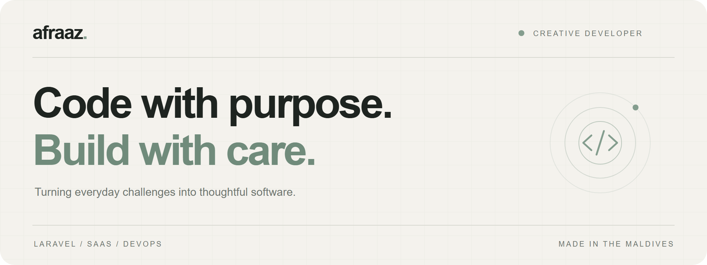
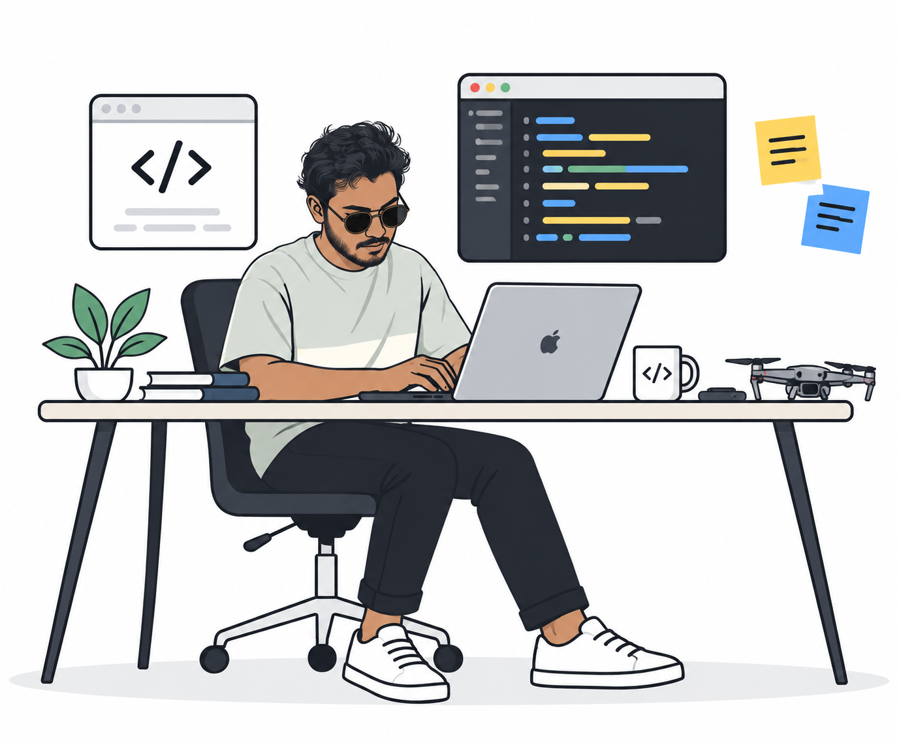
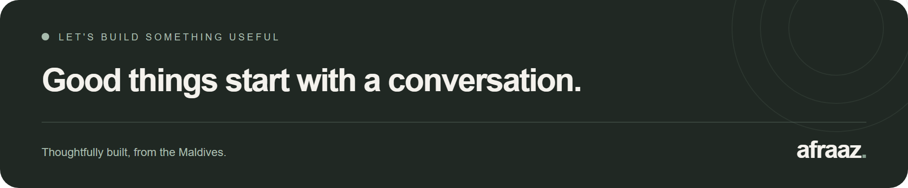



 
 

# Ahmed Afraaz

**Full Stack Developer &nbsp; / &nbsp; SaaS Builder &nbsp; / &nbsp; DevOps**

Building useful things with a thoughtful approach to design and code.

[Email](mailto:hello@ahmedafraaz.com) &nbsp; ↗ &nbsp; [LinkedIn](https://linkedin.com/in/ahmedafraaz) &nbsp; ↗ &nbsp; [GitHub](https://github.com/afrazafey)

 

## A little about me.

I'm a developer based in the Maldives, turning everyday business challenges into software that feels straightforward to use. I work across the stack, from Laravel applications and interfaces to the infrastructure behind them.

I enjoy the whole process: understanding the problem, building the right solution, and refining the details that make it work well.

 

## What I do.

| Focus | Approach |
| :--- | :--- |
| **Web applications** | Laravel backends, APIs, and clear interfaces for everyday work. |
| **SaaS platforms** | Multi-tenant architecture, subscriptions, and maintainable foundations. |
| **Infrastructure** | Linux servers, Docker, deployment pipelines, and reliable delivery. |
| **AI & automation** | Practical integrations that simplify workflows and reduce repetitive tasks. |

 

## Tools of the trade.

| | My toolkit |
| :--- | :--- |
| **Backend** | PHP · Laravel · REST APIs |
| **Frontend** | JavaScript · TypeScript · Vue · Alpine.js · Tailwind CSS · Vite |
| **Data** | MySQL · PostgreSQL · Redis |
| **Infrastructure** | Linux · Docker · Nginx · GitHub Actions · Cloudflare |
| **Everyday** | Git · VS Code · Postman · Python · Bash |

 

> Curious by nature. Developer by choice.
>
> Currently exploring AI integrations, better automation, and simpler ways to build.

 

## A little progress, every day.

<picture>
  <source media="(prefers-color-scheme: dark)" srcset="https://raw.githubusercontent.com/afrazafey/afrazafey/output/github-snake-dark.svg">
  <source media="(prefers-color-scheme: light)" srcset="https://raw.githubusercontent.com/afrazafey/afrazafey/output/github-snake.svg">
  
</picture>

 

 
 

**[Start a conversation](mailto:hello@ahmedafraaz.com)** &nbsp; · &nbsp; **[Connect on LinkedIn](https://linkedin.com/in/ahmedafraaz)**

 

AHMED AFRAAZ &nbsp; / &nbsp; CODE WITH CARE.

# afrazafey
