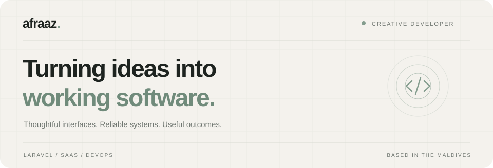

<div align="center">



# Your profile, ready to share.

The same warm ivory, sage green, and dark ink as your portfolio.
<br>
Your original workspace illustration, at the heart of it.

**[Preview the profile →](README.md)**

</div>

---

## Just the essentials.

```text
README.md                    Your public profile
README_SETUP.md              This guide
.github/workflows/
  snake.yml                  Daily contribution snake generator
assets/
  coder-workspace.png         Your original, unchanged illustration
  hero.svg                    Portfolio-themed introduction
  footer.svg                  Matching contact banner
```

The profile needs no local build step or personal access token. The contribution snake is generated by GitHub Actions using the automatic repository token; the other artwork is stored locally.

## Publish in a few steps.

1. Open the public profile repository named **`ahmedafraaz/ahmedafraaz`**. The repository name must match your GitHub username.
2. Upload `README.md`, the three files in `assets/`, and `.github/workflows/snake.yml`, preserving the folder structure above.
3. Commit to the default branch and open your GitHub profile.

This guide is for your reference and does not need to be uploaded.

## Start the contribution snake.

1. Commit `.github/workflows/snake.yml` to the default branch. A push to `main` or `master` starts it automatically.
2. Open **Actions → Contribution Snake → Run workflow** if you need to start it manually. Enable Actions if GitHub prompts you.
3. Wait for **Generate and publish snake** to finish successfully. It creates the `output` branch and publishes `github-snake.svg` and `github-snake-dark.svg` there.
4. Refresh your profile. The animation switches between light and dark sage palettes to match the visitor's appearance settings.

The workflow refreshes daily at **05:17 Maldives time (00:17 UTC)**; scheduled runs can be delayed by GitHub. There is no need to create the `output` branch yourself or enable GitHub Pages.

If the animation is missing, check the workflow's latest run first. A `403` while publishing usually means repository or organization Actions policy is preventing writes: allow the workflow's `contents: write` permission. The README's two raw image URLs must also match your repository owner and name. The image becomes available after the first successful run.

## Keep your details accurate.

The existing contact details are retained in the profile. Check them before publishing:

| Detail | Current value |
| :--- | :--- |
| Name | Ahmed Afraaz |
| GitHub | `ahmedafraaz` |
| Email | `hello@ahmedafraaz.com` |
| LinkedIn | `linkedin.com/in/ahmedafraaz` |

Edit the introduction, toolkit, and contact links in `README.md`. The banners are editable SVGs; the workspace illustration is your supplied PNG.

## Your visual theme.

| Color | Value | Use |
| :--- | :--- | :--- |
| Warm ivory | `#f4f2ed` | Header background |
| Sage | `#849d8e` | Accents and wordmark dot |
| Dark ink | `#1e2420` | Main lettering |
| Forest | `#202823` | Footer background |
| Muted gray | `#6f7670` | Supporting text |

The banner artwork carries your portfolio colors. The surrounding text follows the visitor's GitHub appearance settings.

If an image is missing, check that its filename and `assets/` path match the README exactly. GitHub filenames are case-sensitive.

---

<div align="center">
<sub>AFRAAZ. &nbsp; / &nbsp; THOUGHTFULLY BUILT.</sub>
</div>
